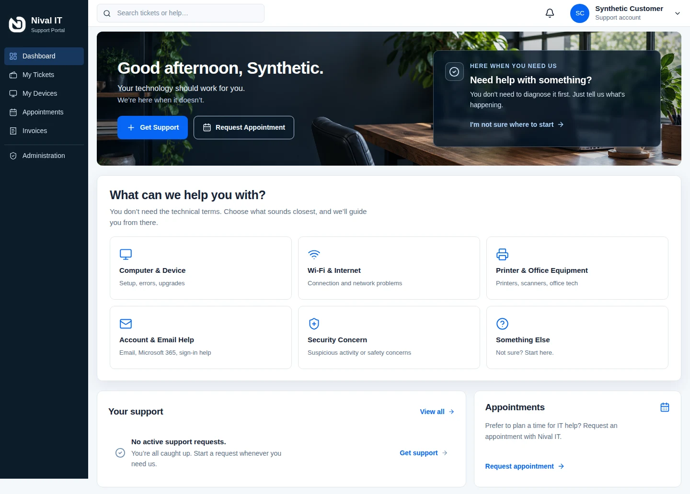

  

Building things, fixing things, figuring things out.

🛠️ IT &nbsp; · &nbsp; 🔐 Security &nbsp; · &nbsp; 🌱 Always learning

---

### 🛠️ On the workbench

**[Support portal · build notes](https://github.com/pickproof/nival-it-portal-showcase)**  
A look at what I’m building, the decisions behind it, and lessons from testing. *In development.*

Development UI · synthetic data · [Explore the gallery and build notes →](https://github.com/pickproof/nival-it-portal-showcase)

### 🔎 Field notes

**[Windows integrity repair](./notes/windows-integrity.md)** — a short retrospective on repair, follow-up checks, and keeping conclusions scoped.

### 🚧 Up next

Security lab notes with findings and takeaways as labs are completed.

Small steps, documented.
