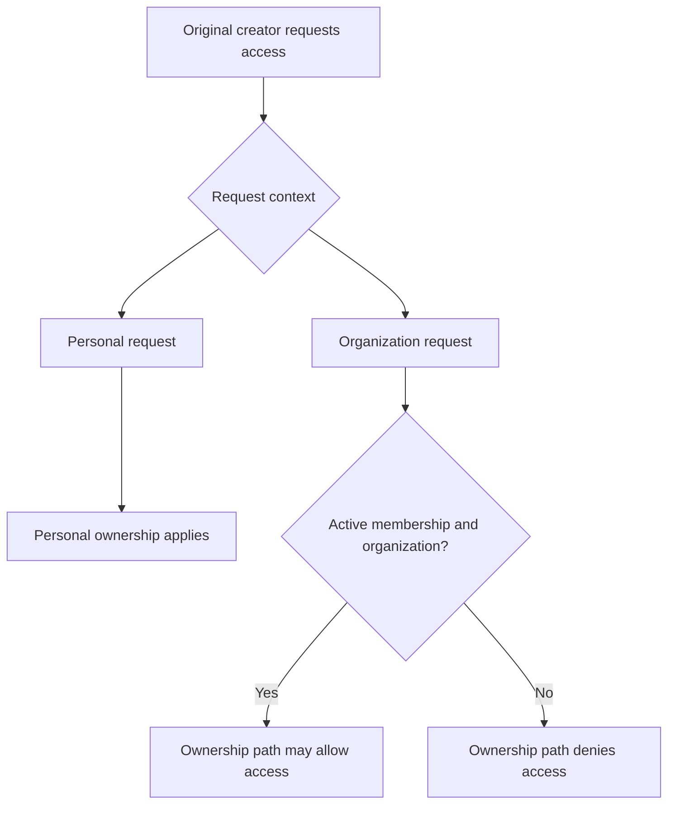

# Support portal · build notes

**In development · November 2026**

Getting IT help should be easy. I’m working on a portal that brings support requests, replies, and updates into one place, with customer and administration experiences.

These notes follow the decisions behind the project: making requests understandable, keeping access appropriate, and checking that changes behave as intended.

## A look inside

*Desktop customer dashboard. Plain-language categories help someone start without having to diagnose the problem first.*

<table>
<tr>
<td width="35%" valign="top">

</td>
<td valign="top">
<h3>A smaller first step</h3>

The request flow starts with a familiar question: what do you need help with? Categories lead into a guided sequence.

The design work includes mobile layouts, readable choices, and keeping the next action clear.

</td>
</tr>
</table>

*Administration overview showing request states and navigation.*

**About these images:** actual application renders from automated visual fixtures using synthetic identities and counts, captured November 3, 2026. They illustrate development UI; visible navigation does not establish that every feature is released or fully accepted.

## Build note 01 · Access should follow current membership

An organization request has an original creator, but that person’s relationship with the organization can change. Testing an earlier implementation showed that ownership alone could preserve access after membership was removed.

**Creating a record and remaining authorized to access it are separate questions.**

| Context | Intended behavior |
| --- | --- |
| Personal request | Preserve the original owner’s personal access. |
| Organization request, original creator | Require active membership in an active organization. |
| Organization manager | Appropriate organization reads do not automatically grant owner-only actions. |
| Membership removed | Earlier ownership must not preserve organization access. |

*Conceptual original-creator access path. Other role and session checks also apply.*

### What changed and how it was checked

The correction makes original-creator access to organization requests depend on current membership and organization status. Personal ownership remains separate, as does the distinction between viewing a request and performing owner-only actions.

The reviewed TEST records describe synthetic-account checks in which an already-issued session lost organization-request access after membership removal. Related checks covered legitimate personal access, manager read-only scope, inactive organizations, and denied actions.

Those results belong to dated TEST versions. They do not establish that every workflow or production release is ready. The project remains in development.

### What I’m taking forward

- Test denied behavior alongside successful behavior.
- Enforce permissions beneath the interface.
- Test relationships changing during an existing session.
- Keep evidence tied to a version and environment.
- Distinguish an implemented correction from a verified release.

## How I work on this project

I direct the requirements and review the experience, using AI assistance for implementation, investigation, and testing. These notes describe the project decisions and learning.

## Coming next

- **Request experience:** the choices behind a clearer support journey.
- **Accessibility:** making a public-reply warning available to assistive technology.
- **Verification:** what automated checks establish and what still needs a real-session check.

Application source remains private. This public showcase contains selected development images and learning notes. Visual source: b2a6e406578eee00ecc6a9a4afb9734bc92a701f. Permission results refer to earlier dated TEST checkpoints, not a fresh acceptance run performed for this write-up.

[← Back to profile](https://github.com/pickproof)
